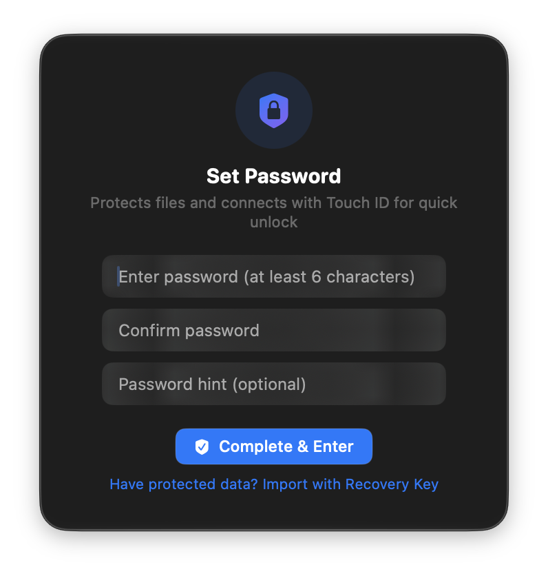
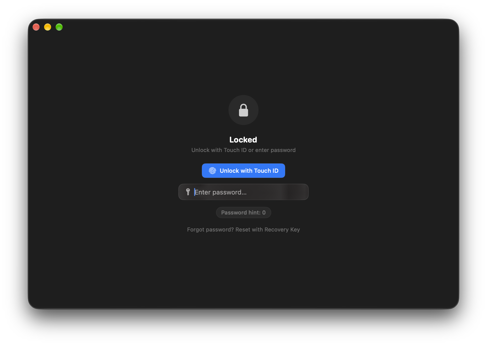
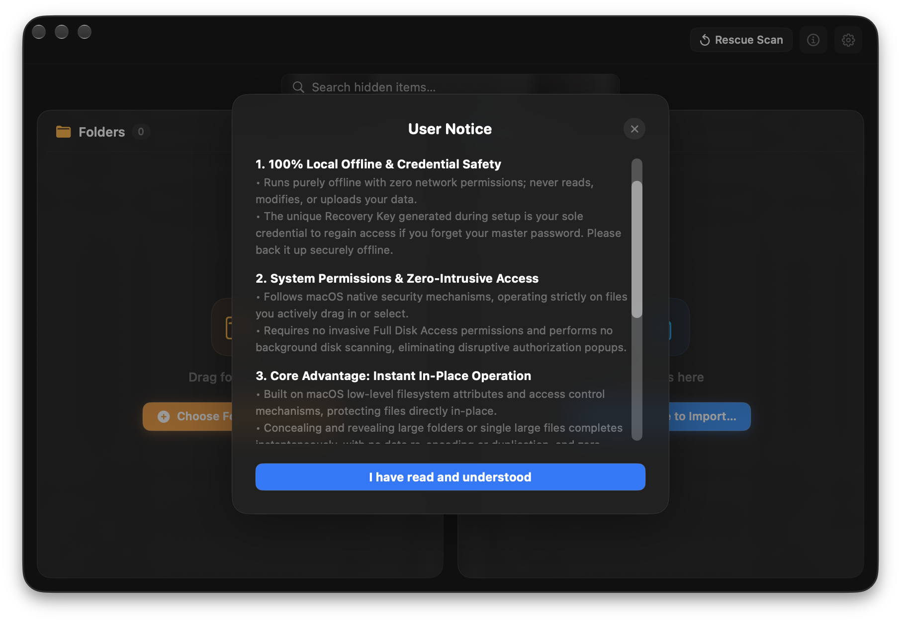
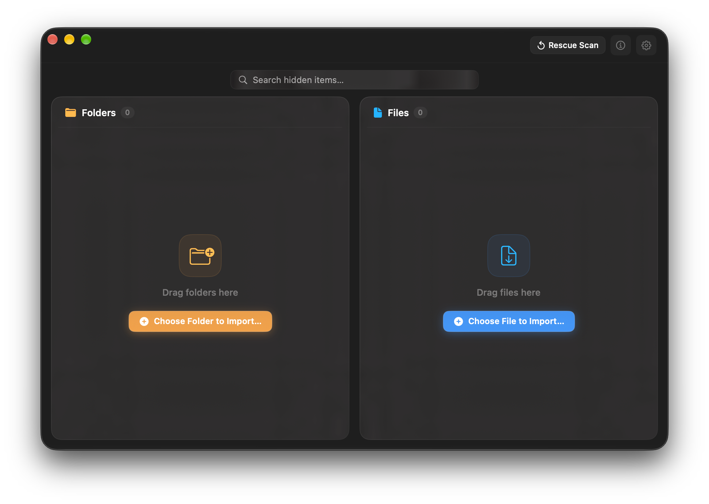
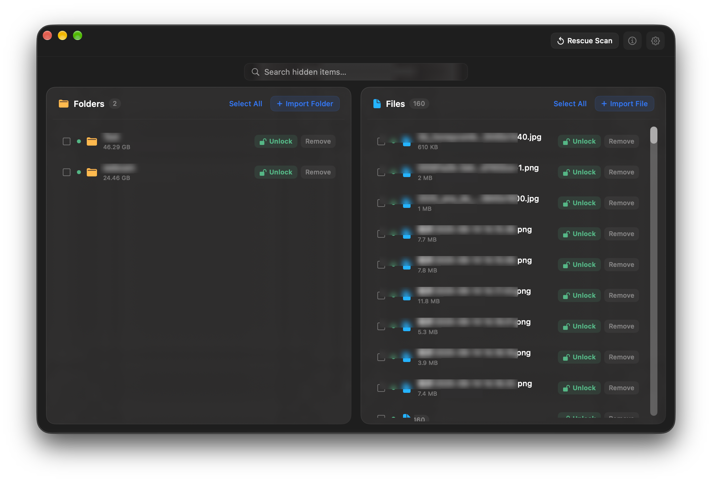
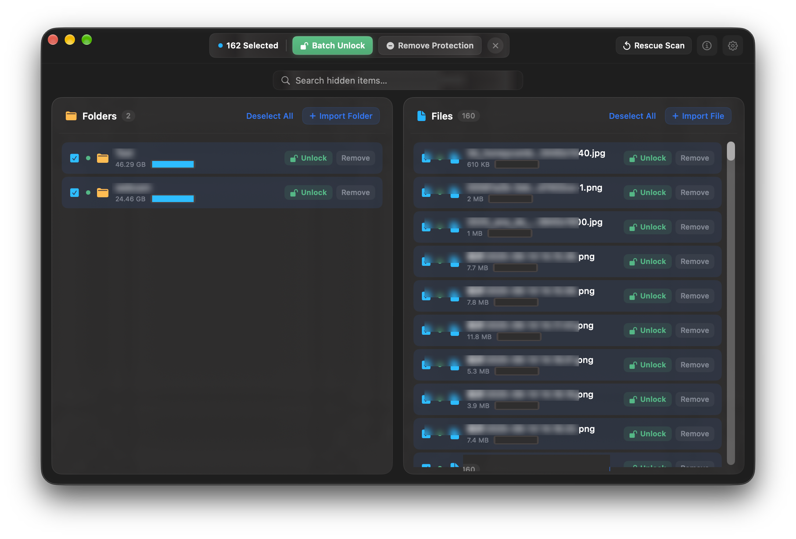
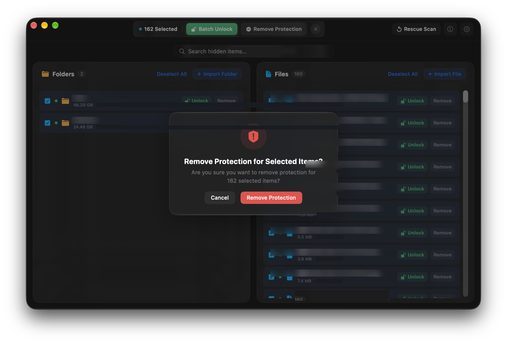
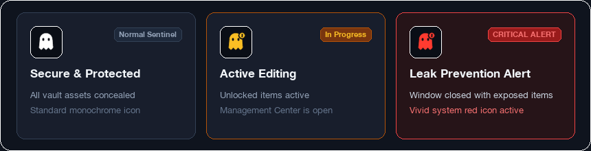
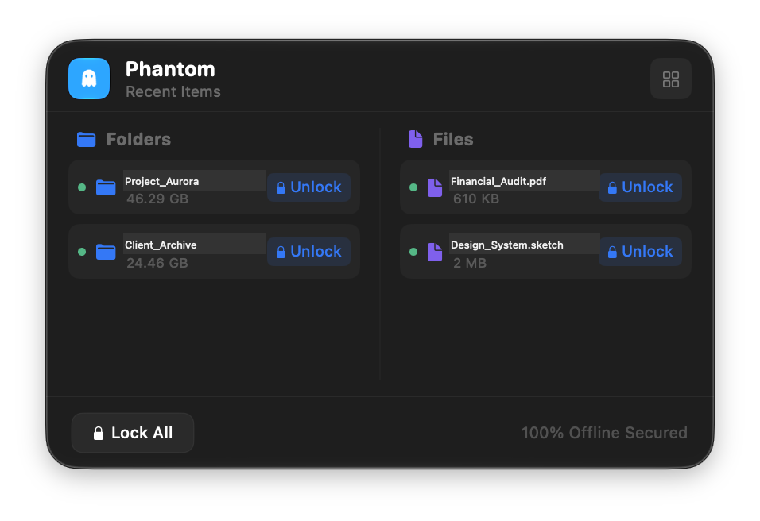
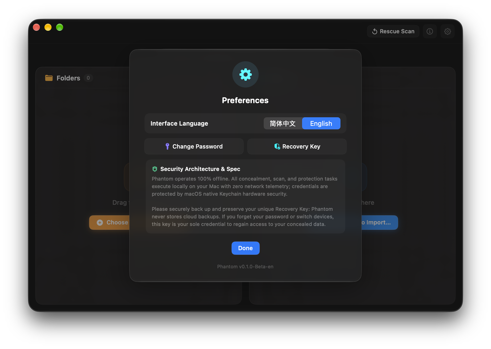

<p align="center">
  
</p>

<h1 align="center">Phantom</h1>

<p align="center">
  <strong>Native macOS In-Place File Concealment & Privacy Guard</strong>
</p>

<p align="center">
  
  
  
  
  
</p>

<p align="center">
  <a href="#overview">Overview</a> •
  <a href="#threat-model--security-boundaries">Threat Model</a> •
  <a href="#core-advantages">Advantages</a> •
  <a href="#emergency-manual-recovery">Manual Recovery</a> •
  <a href="#feature-tour">Features</a> •
  <a href="#verification--entitlements">Offline Verification</a> •
  <a href="README_ZH.md">简体中文</a>
</p>

---

## Overview

In collaborative workspaces, presentations, screen shares, or shared-device environments, work files, personal folders, and staging assets can easily be exposed via Finder directory views, Recent Items, Spotlight searches, or AirDrop menus. Traditional encrypted disk images can take significant time to create and carry data corruption risks on multi-gigabyte files, while relying purely on the macOS login password offers zero privacy isolation when lending a device.

**Phantom** provides native macOS in-place privacy protection: it conceals items instantaneously directly at their original storage paths using Darwin filesystem attributes without data duplication or format rewriting, while establishing an independent master credential to protect your workspace boundaries.

---

## Threat Model & Security Boundaries

To maintain engineering transparency, Phantom clearly defines its protection boundaries:

### What Phantom Protects Against
- **Casual Bystander Snooping**: Hides files and folders in-place so they do not appear in standard Finder directory views.
- **Search & Recent Exposure**: Strips visibility from Spotlight indexing, Siri suggestions, and macOS Recent Items.
- **Accidental Presentation Leakage**: Prevents inadvertent exposure during screen sharing, projector displays, or temporary device handoffs.
- **Accidental Modification**: Applies POSIX permissions `000` and `UF_IMMUTABLE` flags to prevent accidental editing or deletion of locked items.

### What Phantom Does Not Protect Against
- **Forensic & Physical Drive Extraction**: Phantom does **not** re-encode file payloads with block ciphers. File contents remain at their original storage sectors to eliminate write-interruption and corruption risks. Block-level forensic tools can read data directly from unencrypted partitions.
- **Same-User Terminal Execution**: Any process or terminal script running under the same user account with appropriate permissions (e.g., executing `chflags` or `chmod`) can inspect or revert item attributes.
- **System Backups**: Standard file backups (such as Time Machine) may back up hidden files unless specifically excluded in backup settings.

> For environments requiring defense against hardware seizure or hostile forensic inspection, combine Phantom with FileVault full-disk encryption.

---

## Emergency Manual Recovery

Because Phantom modifies native macOS filesystem attributes without payload alteration, your data is never locked inside a proprietary container. If the application is uninstalled, unavailable, or you need emergency manual recovery, execute the following commands in Terminal:

```bash
# 1. Clear hidden and immutable flags
chflags -R nohidden "/path/to/target/folder_or_file"
chflags -R nouchg "/path/to/target/folder_or_file"

# 2. Restore standard POSIX permissions
# For a folder:
chmod -R 755 "/path/to/target/folder"

# For a regular file:
chmod 644 "/path/to/target/file"
```

---

## Core Advantages

- **Instant In-Place Concealment**: Operates directly at original storage paths without copying, moving, or re-encoding data, eliminating data corruption risks on large files.
- **Independent Credentials & Touch ID**: Dedicated master password paired with Touch ID authentication, decoupled from the macOS login password to protect privacy on shared hardware.
- **Proactive Leak Prevention & Visual Sentinel**: Dynamic visual sentinel in the menu bar displays an amber indicator during active editing and transitions to a conspicuous **red alert** if the management window is closed while items remain unlocked.
- **Local Offline Architecture**: Zero network permissions, zero telemetry, and zero remote communication. Credentials reside in the macOS Keychain (`ThisDeviceOnly`).
- **Native Lightweight Footprint**: Built purely with AppKit and SwiftUI for minimal system footprint and native macOS Liquid Glass aesthetics.

---

## Feature Tour

### 1. Independent Credentials & Biometric Unlock
Enforces a master password separate from system login, integrated with Touch ID for quick unlock.

| Figure 1: Master Password Setup | Figure 2: Lock Screen & Touch ID |
| :---: | :---: |
|  |  |

---

### 2. Operational Notice & Security Guidelines
Presents essential operational rules before first use: clarifies local-only behavior and recommends avoiding targeting active sync drives or download paths directly into locked directories.

<p align="center">
  
</p>

---

### 3. Structured Dual-Column Management Center
Liquid Glass interface partitioning folders and files into equal columns; features instant search filtering and direct Finder drag-and-drop ingestion.

| Figure 4: Empty Initial State | Figure 5: Populated Asset Index |
| :---: | :---: |
|  |  |

---

### 4. Adaptive Batch Operations & Row Controls
The top toolbar dynamically switches between batch actions based on selection state. Rows provide direct unlock toggles, Finder reveals, and confirmation modals against accidental removal.

| Figure 6: Adaptive Batch Toolbar | Figure 7: Row Actions & Finder Reveal |
| :---: | :---: |
|  |  |

---

### 5. Menu Bar Floating Panel & Active Leak Prevention
Resides in the macOS menu bar with an intelligent visual sentinel: displays an amber indicator during active editing and transitions to an eye-catching **red alert** if the management window is closed while items remain unlocked and exposed in Finder.

<p align="center">
  
</p>

<p align="center">
  
</p>

---

### 6. Preferences & Dedicated Recovery Key
Supports instant bilingual switching and password updates. The high-entropy Recovery Key generated at setup serves as the primary credential to regain access offline.

<p align="center">
  
</p>

---

## Verification & Entitlements

Phantom operates completely offline. You can independently verify that network access is absent by inspecting the binary entitlements:

```bash
codesign -d --entitlements :- /Applications/Phantom.app
```

Entitlements definition (`Phantom.entitlements`):
```xml
<?xml version="1.0" encoding="UTF-8"?>
<!DOCTYPE plist PUBLIC "-//Apple//DTD PLIST 1.0//EN" "http://www.apple.com/DTDs/PropertyList-1.0.dtd">
<plist version="1.0">
<dict>
    <key>com.apple.security.cs.allow-jit</key>
    <false/>
    <key>com.apple.security.personal-information.photos-library</key>
    <false/>
    <!-- Notice: com.apple.security.network.client and network.server are strictly omitted -->
</dict>
</plist>
```

---

## System Requirements

- **Operating System**: macOS 14.0 (Sonoma) or later
- **Architecture**: Apple Silicon (M1 / M2 / M3 / M4 series chips)
- **Recommended Hardware**: Mac models or Magic Keyboards equipped with Touch ID

---

## Quick Start

1. Download `Phantom-v0.1.0-Beta-en.dmg` (or Chinese `-v0.1.0-Beta.dmg`) from Releases;
2. Mount the disk image and drag **Phantom** into your `Applications` folder;
3. Launch the app, configure your master password, and securely archive your Recovery Key;
4. Click the menu bar icon or drag files into the management window to begin protection.

---

## Licensing & Governance

- **Copyright © 2026 Phantom Team. All rights reserved.**
- Subject to the terms of the proprietary [LICENSE](LICENSE).
- Security policy and vulnerability reporting: [SECURITY.md](SECURITY.md).
- Privacy policy and offline commitments: [PRIVACY.md](PRIVACY.md).
