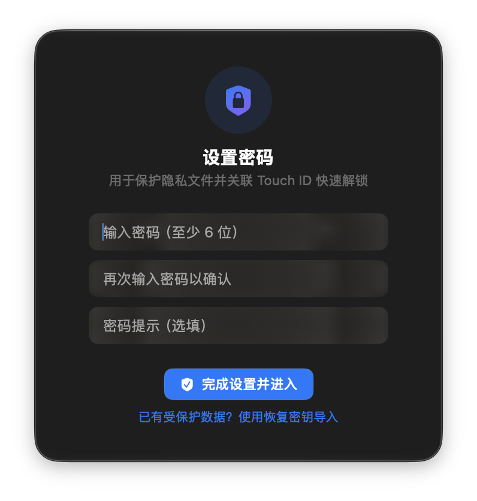
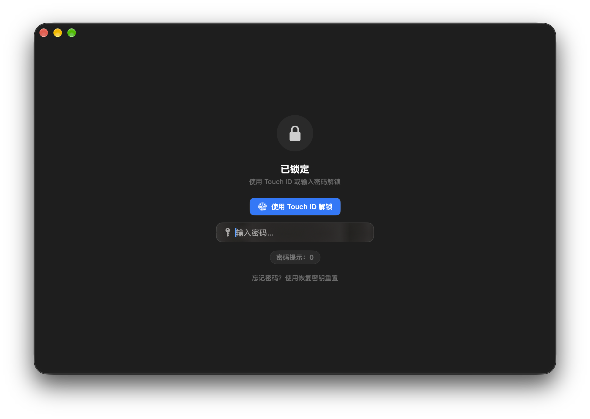
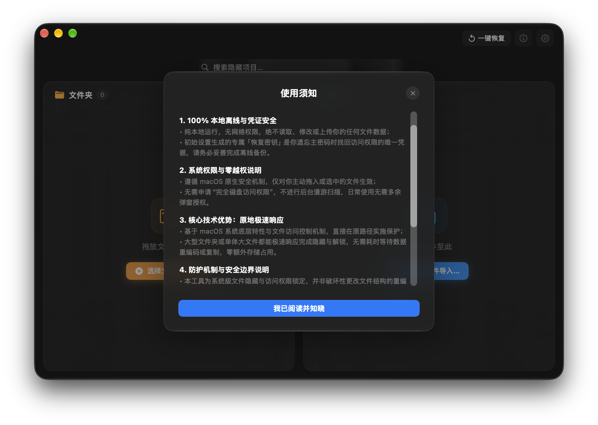
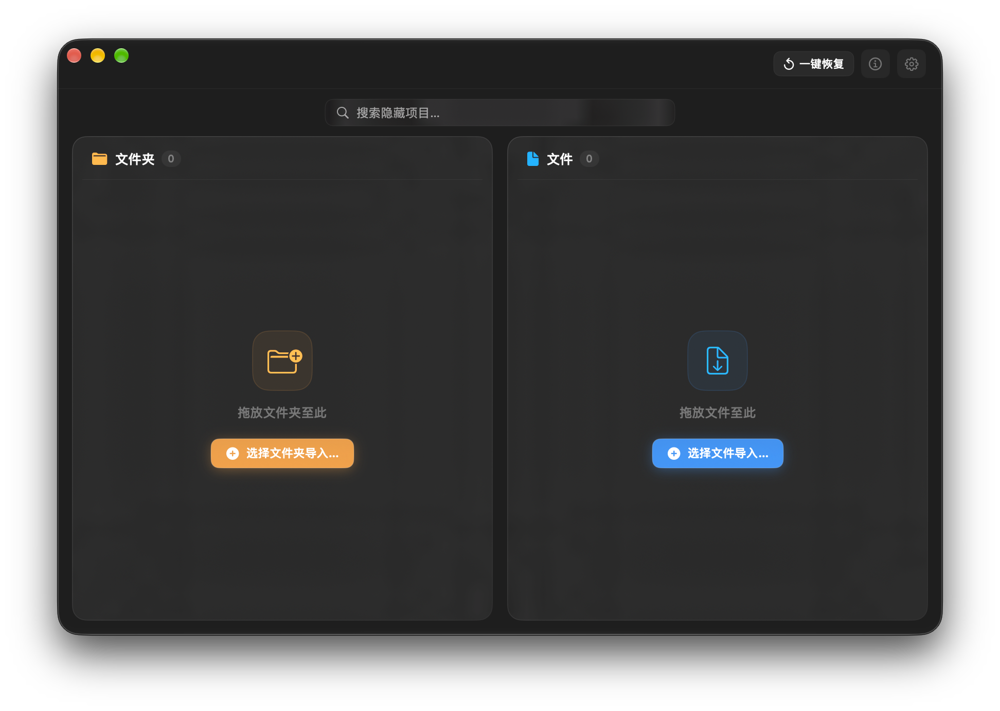
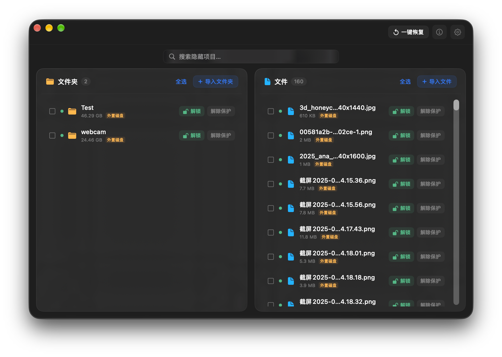
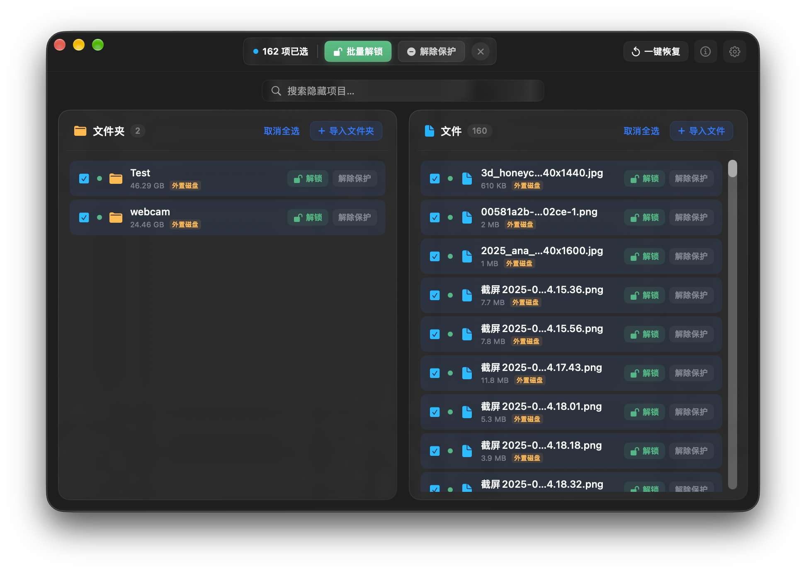
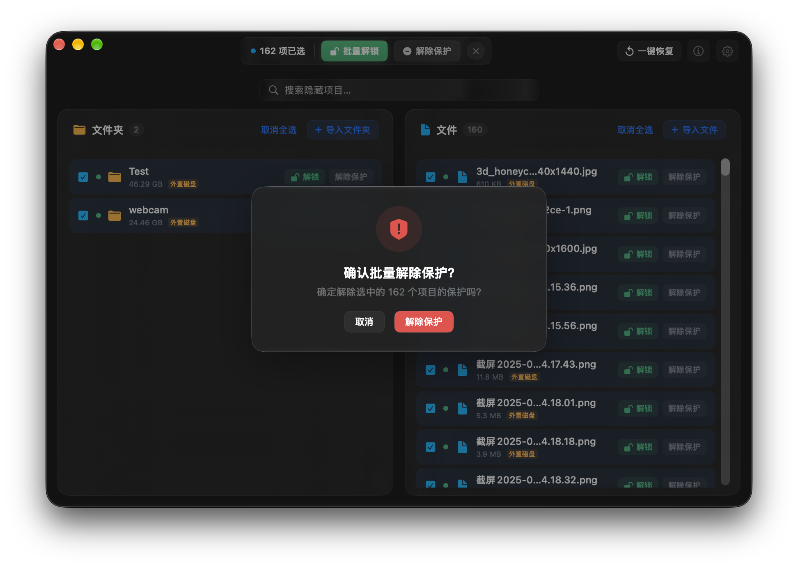
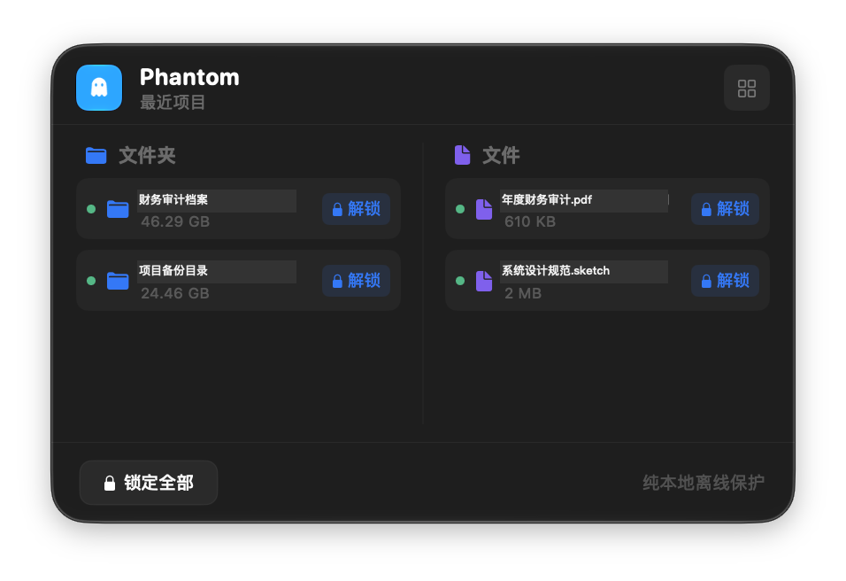
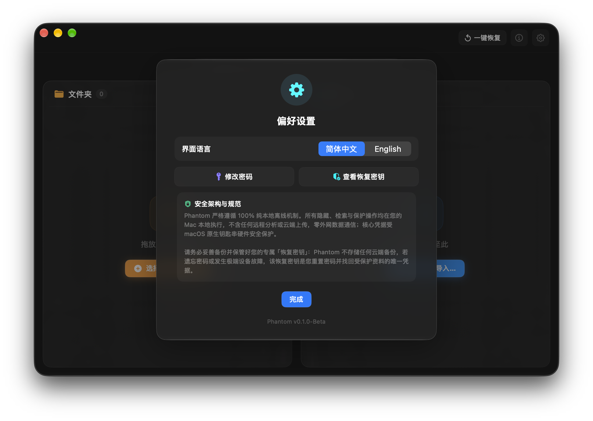

<p align="center">
  
</p>

<h1 align="center">Phantom</h1>

<p align="center">
  <strong>基于 macOS 原生机制的原路径文件隐藏与独立密码防护工具</strong>
</p>

<p align="center">
  
  
  
  
  
</p>

<p align="center">
  <a href="#软件介绍">软件介绍</a> •
  <a href="#防护边界与安全模型">安全模型</a> •
  <a href="#核心优势">核心优势</a> •
  <a href="#应急手动恢复指南">手动恢复</a> •
  <a href="#功能预览">功能预览</a> •
  <a href="#权限与离线验证">离线验证</a> •
  <a href="README.md">English Version</a>
</p>

---

## 软件介绍

在日常办公、会议投屏演示或与他人临时共用 Mac 时，工作文档、个人资料或暂存项目容易在访达目录检索、最近使用、聚焦搜索或隔空投送列表中被旁人无意查看。传统加密磁盘镜像建立耗时长且可能存在大文件写入中断损毁风险，而直接借用系统锁屏密码更无法提供独立的隐私隔离。

**Phantom** 专为 macOS 深度打造：直接基于 Darwin 原生文件属性控制在原存储路径实现就地隐藏，无需漫长的数据搬迁或格式重编码，同时建立独立于系统登录密码的专属凭据体系，以原生轻量形式守护个人数字工作边界。

---

## 防护边界与安全模型

为保持工程透明度，Phantom 明确界定其防护能力边界：

### 适用防护场景
- **旁人随手翻看与窥视**：在原路径隐藏文件与文件夹，不在普通访达目录视图中列出。
- **系统搜索与最近记录**：从聚焦搜索（Spotlight）、Siri 建议与 macOS 最近使用记录中剔除可见性。
- **会议投屏与演示防误露**：防止在屏幕共享、投影展示或临时借出电脑时误露出敏感文件。
- **误操作防护**：对受保护项设置 POSIX 权限 `000` 并标记 `UF_IMMUTABLE`，防止锁定期间被误修改或意外删除。

### 不防范的安全边界
- **底层硬件取证与直接物理读取**：Phantom **不进行**破坏性重编码加密容器封装，文件底层数据依然保留在原始磁盘块中，以避免写入中断造成的数据损坏风险。底层取证工具可直接从无全盘加密的分区中读取原始数据块。
- **同账户终端与高级进程**：任何以当前 macOS 用户身份运行且具备适当权限的进程或终端命令（如 `chflags`、`chmod`）均可查看或还原相关属性。
- **系统级全量备份**：未在备份设置中显式排除的前提下，常规文件备份工具（如 Time Machine）仍可能备份受隐藏的文件。

> 若面临设备丢失、硬件扣押或高级恶意取证威胁，请务必配合开启 macOS 系统级 FileVault 全盘加密功能。

---

## 应急手动恢复指南

由于 Phantom 仅修改原生文件系统属性而不破坏文件底层内容，你的数据不会被锁定在任何私有容器中。即使软件被卸载、不可用或遇到异常情况，均可通过系统终端（Terminal）执行标准命令手动恢复可见性与访问权限：

```bash
# 1. 清除隐藏标志与系统不可变保护标志
chflags -R nohidden "/path/to/target/folder_or_file"
chflags -R nouchg "/path/to/target/folder_or_file"

# 2. 恢复标准 POSIX 读写权限
# 针对文件夹：
chmod -R 755 "/path/to/target/folder"

# 针对普通文件：
chmod 644 "/path/to/target/file"
```

---

## 核心优势

- **原路径快速响应**：直接在原路径实施隐藏保护，大文件无需耗时复制或转码，无额外存储开销，避免写入中断造成的数据损坏风险。
- **独立密码与生物识别**：建立专属主密码并联动 Touch ID，与 macOS 开机密码独立隔离，降低设备借出时的泄露风险。
- **主动防遗忘与状态栏警示**：集成动态视觉哨兵机制，编辑期间呈橙色提示；若在存在未锁定项目时关闭管理中心，状态栏立即转为醒目的红色警示，提示及时重新锁定。
- **纯本地离线运行**：无网络权限、无后台遥测、无云端上传，核心凭据受系统钥匙串（`ThisDeviceOnly`）本地安全隔离。
- **原生轻量体验**：采用纯 AppKit + SwiftUI 构建，安装包体积轻量纯净，常驻菜单栏与双栏管理中心协同工作。

---

## 功能预览

### 1. 独立账户体系与生物识别验证
设定独立于系统密码的专属主密码，搭配 Touch ID 实现快速验证。

| 图 1：初次密码设置 | 图 2：锁屏验证与 Touch ID |
| :---: | :---: |
|  |  |

---

### 2. 安全规范与使用须知
首次进入主界面必须知悉的核心条款：明确纯本地离线与原路径特性，指导合规使用。

<p align="center">
  
</p>

---

### 3. 直观严谨的双栏管理中心
通透 Liquid Glass 材质，文件夹与文件双栏平分陈列，容量与状态清晰明了；支持常驻即时搜索与访达直接拖拽纳管。

| 图 4：管理中心空白初始态 | 图 5：管理中心数据列表态 |
| :---: | :---: |
|  |  |

---

### 4. 自适应批量管理与单项操作
顶栏控制条随当前选中项自动切换（批量解锁/锁定）；条目右侧提供独立解锁与访达直达（Reveal in Finder），解除保护具备防误触二次确认。

| 图 6：批量自适应管理条 | 图 7：单项操作与访达直达 |
| :---: | :---: |
|  |  |

---

### 5. 常驻状态栏小窗口与主动防遗忘警示
常驻顶部菜单栏，具备双重智能视觉哨兵：日常编辑时以橙色指示灯提醒未锁定资产；当管理中心关闭或退入后台、但仍有项目处于未锁定状态时，状态栏图标会立即发出强烈的红色警示。

<p align="center">
  
</p>

<p align="center">
  
</p>

---

### 6. 偏好设置与专属恢复密钥
支持中英双语即时切换与凭据重设；初次配置生成的专属「恢复密钥」是离线状态下重置密码并找回受保护资产的关键凭据。

<p align="center">
  
</p>

---

## 权限与离线验证

Phantom 纯本地运行，不含任何网络通信能力。你可以通过终端命令检查签名与沙盒权限配置进行验证：

```bash
codesign -d --entitlements :- /Applications/Phantom.app
```

权限声明清单（`Phantom.entitlements`）：
```xml
<?xml version="1.0" encoding="UTF-8"?>
<!DOCTYPE plist PUBLIC "-//Apple//DTD PLIST 1.0//EN" "http://www.apple.com/DTDs/PropertyList-1.0.dtd">
<plist version="1.0">
<dict>
    <key>com.apple.security.cs.allow-jit</key>
    <false/>
    <key>com.apple.security.personal-information.photos-library</key>
    <false/>
    <!-- 说明：未声明任何网络客户端（network.client）或服务端（network.server）权限 -->
</dict>
</plist>
```

---

## 系统要求

- **操作系统**：macOS 14.0 (Sonoma) 或更高版本
- **架构平台**：Apple Silicon (M1 / M2 / M3 / M4 全系列芯片)
- **推荐硬件**：支持 Touch ID 的 Mac 设备或键盘

---

## 快速上手

1. 前往 Releases 下载 `Phantom-v0.1.0-Beta.dmg`（英文版对应 `-en.dmg`）；
2. 打开镜像并将 **Phantom** 拖入 `Applications` 文件夹；
3. 启动应用，依引导创建专属主密码并备份恢复密钥；
4. 点击顶部状态栏图标或将文件拖入管理中心即可开启保护。

---

## 许可与合规治理

- **版权所有 © 2026 Phantom Team. 保留所有权利。**
- 商业闭源软件，遵循专有软件许可协议：[LICENSE](LICENSE)。
- 安全响应与漏洞披露通道：[SECURITY.md](SECURITY.md)。
- 隐私政策与零网络承诺：[PRIVACY.md](PRIVACY.md)。
